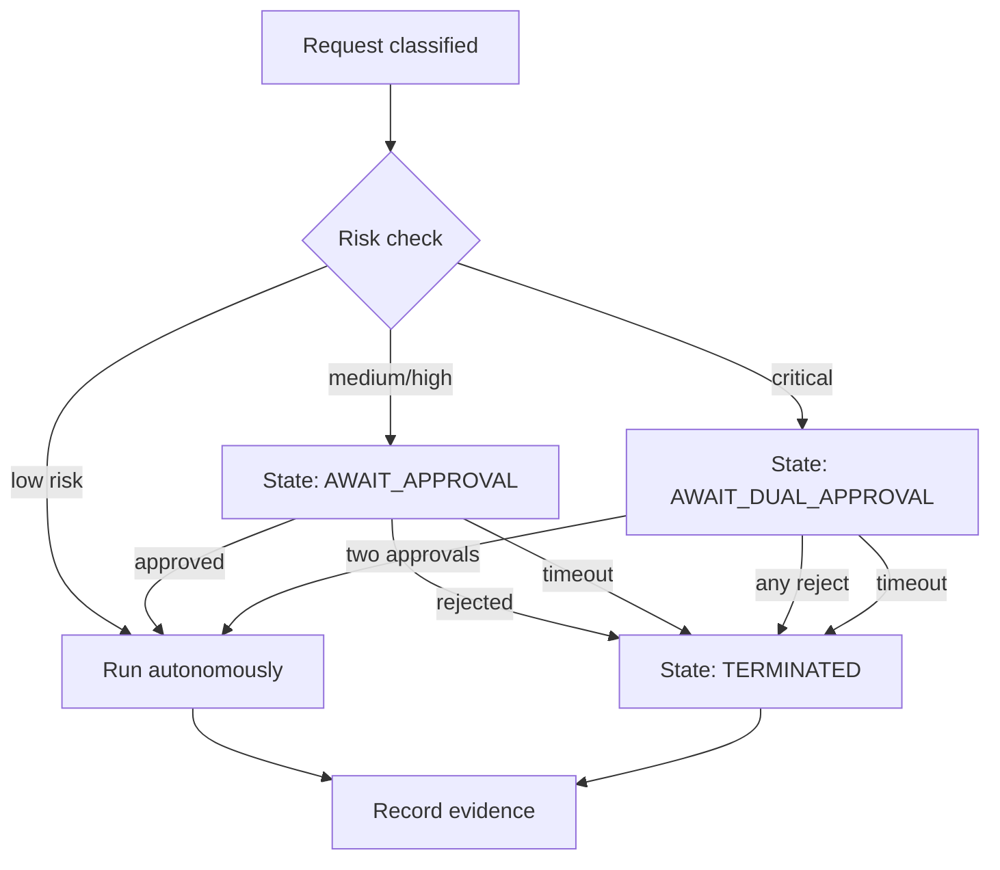

The question that separates a pilot from a production deployment is never *"how capable is the agent?"* It is *"who decides, and under what rules?"* An agent with a model's judgment and a human's privileges is the most dangerous thing you can ship — not because the model is malicious, but because **unearned authority fails at exactly the moment you are not watching**.

I have spent the last ten years building systems that must be responsible at 2 a.m., and the pattern that survives contact with compliance officers is the same every time: autonomy is not a slider you turn up. It is a **governance contract** — a precise, machine-readable agreement about what the agent may do on its own, what it must pause for, who escalates, and what evidence is kept of every human decision. This post is that contract, built from the same foundations as my posts on agent architecture, sandboxing, and state-graph orchestration.

## 1. Autonomy is a per-action decision, not a global setting

The most common governance mistake is a global dial: *"the agent is 40% autonomous."* That number is meaningless to a system that must email a customer, write to a billing database, and draft an internal summary in the same hour — these actions do not share a risk profile.

Governance has to be attached to the **action**, not to the agent. For every tool or transition, you declare three things:

- **Risk class.** What is the worst credible outcome if this runs wrong? (data corruption, money movement, PII exposure, external communication, read-only analysis)
- **Authorization model.** May the agent act unilaterally, must a human approve first, or is the action forbidden entirely?
- **Evidence requirement.** What must be recorded before and after, so the decision is replayable?

```yaml
# policy/actions.yaml — governance attached to the action, not the agent
actions:
  search_internal_docs:
    risk: low
    authority: autonomous          # read-only, no approval
  draft_reply_email:
    risk: medium
    authority: require_approval    # human reviews content + recipients
  update_customer_record:
    risk: high
    authority: require_approval
    approver_role: account_owner
  issue_refund:
    risk: critical
    authority: require_dual        # two-person rule
    approver_role: [finance_manager, compliance]
  delete_production_row:
    risk: critical
    authority: forbidden           # no path exists
```

The rule of thumb I use with teams: **if the failure is reversible and invisible, the agent can act alone. If the failure is irreversible or externally visible, a human signs off.** Everything in between is a policy decision your organization should make explicitly, not the model by default.

## 2. Risk classification: the governance engine's first decision

Every incoming request must be classified into a risk class before it touches a tool. This is not a prompt asking the model *"is this risky?"* — that is a governance decision delegated back to the thing you are governing. Classification is a deterministic pipeline:

1. **Intention extraction** — what the agent intends to do (a structured action, not free text).
2. **Target inspection** — what it intends to act on (table, API, recipient, monetary amount).
3. **Policy lookup** — the risk class and authorization model for that action×target pair.
4. **Override guards** — deny-by-default rules that fire regardless of the model's self-assessment.

```python
def classify(request: AgentRequest, policy: Policy) -> Decision:
    action = extract_intent(request)            # structured, not free text
    target = inspect_target(request)            # object, field, recipient, amount

    # 1. Hard deny rules always win (deny-by-default).
    if policy.forbidden(action, target):
        return Decision.deny("action forbidden by policy")

    # 2. Risk class from the action/target pair.
    risk = policy.risk_class(action, target)

    # 3. Authorization model per risk class.
    if risk == "critical":
        return Decision.require_approval(risk, roles=policy.roles_for(action))
    if risk == "high":
        return Decision.require_approval(risk, roles=policy.roles_for(action))
    if risk == "medium":
        return Decision.require_approval(risk, roles=policy.roles_for(action))
    return Decision.authorize(risk)              # low risk: run autonomously
```

Note what this buys you: the model cannot **self-escalate its own privileges** by describing a dangerous action in safe-sounding words, because the decision is made on the structured action and target, not on the model's prose. This composes directly with the sandbox layer I described in my post on tool execution — governance decides *whether* an action may happen; the sandbox decides *where* it runs.

## 3. The approval gate is a state machine with a timeout

A governance gate is not a Slack notification you hope someone answers. It is a **state** with a deadline, an owner, and a fail-closed path — exactly the pattern state-graph orchestration makes first-class.



The non-negotiables for a production gate:

- **Every gate has a timeout.** An approval that can hang forever is a queue you will discover at 3 a.m. On timeout, fail closed — terminate, do not auto-approve.
- **Approvals are bounded, not open-ended.** The approver reviews a *scoped payload*: the action, the target, the risk class, and the evidence snapshot. They do not review the whole agent conversation.
- **Rejection is a terminal state with a reason.** You capture *why* a human said no. That reason is the single most valuable training signal your governance system produces — it is how autonomy learns its real boundaries.

```text
ApprovalTicket {
  id: "at_9f3c21",
  action: "update_customer_record",
  target: "customer:acme_0417",
  risk: "high",
  requires: "account_owner",
  evidence: "sha256:7b2e...",      # snapshot hash, not raw PII
  expires_in: "30m",
  on_timeout: "terminate"          # fail closed
}
```

## 4. Escalation: the matrix is written down before the incident

The second most common failure is that nobody has decided *who decides when the first approver is unavailable or conflicted*. Your governance contract must answer the escalation question in advance — not during the incident.

A practical escalation matrix for agent actions:

| Risk | Primary approver | Escalation (after N min) | Final authority |
|------|-----------------|--------------------------|-----------------|
| Low | — (autonomous) | — | — |
| Medium | Duty engineer | Team lead (15m) | On-call manager |
| High | Account owner | Engineering manager (30m) | Head of engineering |
| Critical | Finance + compliance (dual) | CTO + compliance lead (45m) | CEO sign-off |

Two properties make this usable, not decorative:

- **Escalation is automatic and time-driven**, not a human remembering to ping someone. The state machine raises the ticket after N minutes; it does not wait for someone to notice.
- **Every rung re-evaluates risk.** Escalating to a more senior person does not mean *"they will approve."* It means a more senior person now *decides* — approval, rejection, or a narrower scope (e.g., "approve the refund, but cap it at $500").

The point of the matrix is that at 2 a.m., with a half-awake engineer and a deadline, **nobody has to invent policy under pressure**. The contract already decided. This is what I mean when I tell teams that governance is the difference between a system you trust and a system you babysit.

## 5. Every human decision is evidence

An audit trail that only records what the *agent* did is half a record. The other half is what the *human* decided — and that half is what compliance actually interrogates. For every gate you must capture:

- **Who** approved, rejected, or escalated (identity, not just a name).
- **What** they were shown (the scoped payload — so you can prove they saw the risk class and the target).
- **When** (timestamp) and **how long they took** (a 3-second approval of a critical action is itself a signal).
- **Why** — the rejection reason, captured as structured data, not prose buried in a log.

```json
{"ts":"2026-10-12T08:41:22Z","ticket":"at_9f3c21",
 "decided_by":"u_wdamouny","role":"account_owner",
 "decision":"approved","scope":"update_customer_record:acme_0417",
 "risk":"high","evidence":"sha256:7b2e...",
 "approved_via":"policy_v2026-10","ttl_sec":38}
```

This record slots straight into the trajectory-log pattern from my post on multi-agent observability. The audit object becomes: *what the agent intended → what the policy allowed → who decided → what ran → what changed.* Five fields, one immutable row, and a compliance sign-off that takes minutes instead of weeks.

## 6. Where governance lives in your stack

Do not bolt governance onto the agent as a callback. It belongs in three concrete places:

1. **Policy-as-code, versioned, reviewed.** The YAML policy above is a deployment artifact with a version and a code review, exactly like infrastructure. Changes go through PR review; the audit trail records *which policy version* made each decision.
2. **In the orchestration layer, as states.** The approval gate is a node in your state graph, not a side effect. That gives you checkpointing, resumability, and observability for free (per my state-graph post).
3. **In the evidence store, append-only.** Human decisions are written to the same WORM-style store as agent trajectories — hashed, immutable, replayable.

The cheap version of this is a policy file and a timeout. The production version adds versioning, escalation, dual-approval, and evidence capture. Start with the cheap version — but start now, because the alternative is discovering your governance gaps the first time the agent touches something that matters.

## Bring governance discipline to your agent stack

If your team has an agent that can call tools with human-level privileges, the question is not *whether* it will need governance — it is whether the contract exists before the incident does. I spend 30 minutes with senior teams reviewing their agent governance: how actions are risk-classified, where the approval gates and timeouts live, whether escalation is written down, and whether the audit trail actually proves who decided what. No obligation, and no product pitch.

Reach me directly at **wisamdamouny@gmail.com** or via the contact form below.
